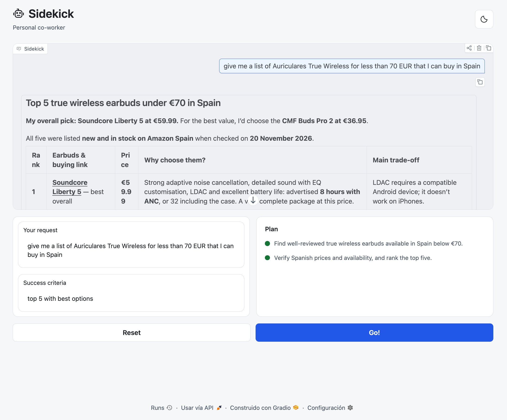
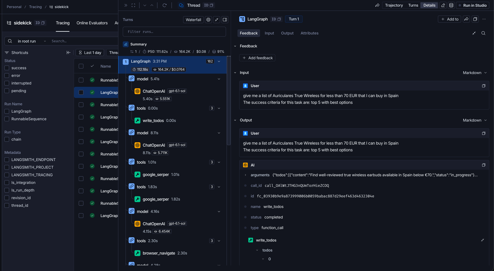

# LangChain Agents Sidekick

A personal assistant project built with LangChain and LangGraph, with a user interface implemented using Gradio. The worker agent plans and completes tasks using web search, Wikipedia, a browser, and local file tools. An evaluator checks the result against your success criteria and sends feedback for up to three attempts. The interface shows the agent's plan as it works and pauses for your approval before sending push notifications or requesting help in the browser.

The app runs locally on your computer and uses online services for model calls, search, and optional notifications.

<p align="center">
  
</p>

> **Lab / experimentation project.** This repo is a learning lab, not a production system.
> It is based on the [Master AI Agentic Engineering - build autonomous AI Agents](https://github.com/ed-donner/agents) course week 4 by Ed Donner.
>
> Author: Sebastian Castañeda.

## Set up

The app requires **Python >=3.12**, `uv`, **Node.js >=20** with `npm` / `npx`, and Google Chrome for the browser tool. The commands below use Python 3.12 on macOS or Linux. Run them from the repository root.

Install Python and the project dependencies:

```bash
uv python install 3.12
uv sync --python 3.12
```

Download the [Playwright MCP](https://github.com/microsoft/playwright-mcp) package ahead of the first run so npm does not prompt for installation while the app starts:

```bash
npx -y @playwright/mcp@latest --help
```

The app starts the Playwright and filesystem MCP servers automatically through `npx`; no separate MCP client configuration is needed. The first startup also downloads the filesystem server and requires an internet connection.

Create a `.env` file in the repository root (or update your existing one) with your own credentials:

```dotenv
OPENAI_API_KEY=your-openai-api-key
SERPER_API_KEY=your-serper-api-key
```

By default, both the worker and evaluator use OpenAI's `gpt-5.4-mini`; use an OpenAI API key with access to that model. `SERPER_API_KEY` is required at startup for Google search through Serper.

To configure the models independently, set these optional variables in `.env`:

```dotenv
WORKER_MODEL=openai:gpt-5.4-mini
EVALUATOR_MODEL=openai:gpt-5.4-mini
```

Both settings use LangChain's `provider:model` format. Each role can use a different provider if its LangChain integration package is installed and its required credentials are configured. The worker model must support tool calling, and the evaluator model must support structured output. Restart the app after changing either setting.

To customize the user agent sent to Wikipedia, set `WIKIPEDIA_USER_AGENT` in `.env`.

To enable push notifications to your phone, add your Pushover credentials:

```dotenv
PUSHOVER_USER=your-pushover-user-key
PUSHOVER_TOKEN=your-pushover-application-token
```

These credentials are only needed when using the notification tool. The app asks for approval before sending a notification. Keep `.env` local; do not commit or upload credentials.

## Tracing with LangSmith (optional)

LangSmith records the agent's execution so you can inspect model calls, tool inputs and outputs, latency, token usage, and costs when available. Sidekick's LangChain and LangGraph integrations support tracing automatically; no application code changes are needed.

Create a LangSmith account and an API key using the [official tracing setup guide](https://docs.langchain.com/langsmith/observability-quickstart). Add the following to the repository-root `.env`, replacing the API key placeholder:

```dotenv
LANGSMITH_TRACING=true
LANGSMITH_ENDPOINT=https://eu.api.smith.langchain.com
LANGSMITH_API_KEY=your-langsmith-api-key
LANGSMITH_PROJECT=sidekick
```

This example matches the project's local configuration: a project-based LangSmith workspace in the EU region. Use `https://api.smith.langchain.com` for a US account. The endpoint must match your account's region. For an agent-based workspace, follow the guide's agent-addressing setup instead of `LANGSMITH_PROJECT`.

Sidekick loads these variables from `.env` at startup. Restart the app, submit a request, then open the `sidekick` project under **Tracing** in LangSmith. Select a run to inspect its model and tool calls, as shown below.

<p align="center">
  
</p>

To disable tracing, set `LANGSMITH_TRACING=false` and restart the app. Keep your LangSmith API key in the local `.env` file.

## Run

```bash
uv run --python 3.12 sidekick/app.py
```

Gradio opens the interface in your browser. You can also open the local URL printed in the terminal, usually [http://127.0.0.1:7860](http://127.0.0.1:7860). Wait for **Go!** to become available while the tools initialize.

Enter your request and, optionally, your success criteria, then click **Go!** or press Enter. The **Plan** panel updates as the agent works, and the chat shows its answer and the evaluator's feedback.

Browser tasks use a separate, visible browser with an isolated session. If the agent needs you to log in, solve a CAPTCHA, or complete two-factor authentication, follow its instructions in that browser window, then click **Approve and continue**. Use the same button to approve a pending push notification.

Files created through the filesystem tools are stored in `sidekick/sandbox/`, which is created automatically. **Reset** clears the conversation and starts a new agent and browser session; files in the sandbox remain. Conversation memory is kept in memory only and is lost when you reset or restart the app.

Stop the server with `Ctrl+C`.
